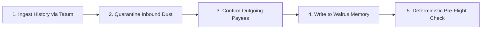

# Your Transaction History Can Be Poisoned. Your Memory Can't.

*By Maris (@Stella112) — Founder & Lead Engineer of Known*  
*Submitted to the Total Recall Hackathon: Tatum × Walrus Memory*  
*Track 03: Consumer Finance Apps | Best Walrus Memory | Best Use of Agent Payments*

---

In December 2025, an experienced cryptocurrency trader copied a wallet address from their own transaction history to send USDT. Within minutes, **nearly $50 million was gone**. 

Just one month later, in January 2026, another user lost **$12.25 million** doing the exact same thing. And on Tron, where everyday peer-to-peer USDT fuels cross-border commerce across emerging markets, a single attacker extracted **$9.4 million from 15 victims in just four weeks**.

According to a peer-reviewed study presented at the **USENIX Security Symposium**, more than **$83.8 million has been documented stolen across 6,633 confirmed incidents** on Ethereum and BNB Chain alone. Security firm Cyvers detects over **1,000,000 poisoning preparations every single day** on Ethereum, while Trust Wallet reports having detected over **225 million poisoning attacks**—a dizzying pace of 34,000 attacks every single hour.

How can seasoned traders, everyday users, and sophisticated teams continue to fall victim to the same trap?

Because the entire industry has misunderstood the vulnerability. **Address poisoning is not a user negligence problem. It is a fundamental memory architecture failure.**

---

## 1. The Root Cause: Transaction History Was Never Meant to Be an Address Book

Ask ten crypto users how they send tokens to someone they've paid before. Nine of them will tell you: *"I find the last transaction we had in my wallet, click copy, and paste it into the send box."*

People treat their blockchain transaction history as their personal memory of who they pay.

**The fatal flaw is that anyone can write into your transaction history.**

In conventional web architecture, a stranger cannot inject entries into your bank account statement or your phone's contact list. But on public blockchains:
1. An attacker observes that you frequently pay your sister or supplier `Ada` (`0x565c...64a38`).
2. Using a vanity key generator, the attacker grinds a keypair whose address starts with the same characters (`0x565...`) and ends with the same characters (`...a38`), with different characters in the middle.
3. The attacker broadcasts an unsolicited **dust transfer** (e.g. 1 MIST or 0.0001 USDT) from their lookalike address directly to your wallet.
4. The scam address now sits silently at the top of your transaction feed. 

When you rush to send funds the next day, you look at the first three characters and last three characters, assume it is your trusted counterparty, and paste it. **You just sent your funds to the attacker.**

---

## 2. Why Existing Solutions Fall Short

Wallet developers have attempted to address this with band-aids:
* **Centralized Blocklists (e.g., Trust Wallet):** Matches addresses against a central database of reported scam addresses. But address poisoning generates fresh, disposable addresses for every single victim. By the time a scam address lands on a central blocklist, the victim's funds are already laundered through mixers.
* **Wallet-Locked Address Books (e.g., MetaMask, Ledger Live):** Users can manually whitelist addresses inside their local wallet app. But today's crypto users navigate multiple wallets, browser extensions, mobile devices, and multi-chain ecosystems (EVM, Sui, Solana, Tron). Nobody wants to maintain four separate address books that disappear the moment they switch devices.

What has been missing is a **sovereign, cross-chain, tamper-proof memory of who you actually pay**—one that cannot be written to by strangers, that travels with you across any wallet, and that gets smarter over time.

That is why we built **Known**.

---

## 3. How Known Works

Known is a decentralized payment memory designed to catch lookalike scams before your money leaves your wallet. It works in three core steps:



### Step 1: Learn Who You Really Pay (Via Tatum)
Known connects to **Tatum's v4 Data API** (for Ethereum, BSC, Polygon, Base, Arbitrum) and **Tatum's Sui GraphQL Gateway**. It pulls your historical on-chain transfers and aggregates them.

Crucially, Known enforces a non-negotiable security invariant: **Inbound-only addresses are strictly quarantined and never suggested as payees.** Known only suggests counterparties you have **actively sent money to**. Because address poisoners only ever send *you* unsolicited dust, their addresses can never enter your candidate list.

With a single tap, you label and confirm your real payees: *"Ada, my sister"*, *"Supplier Alhaji"*, *"Binance Deposit"*.

### Step 2: Store in Walrus Memory (Mainnet)
Each confirmed payee is sealed into a decentralized Walrus Memory account (`@mysten-incubation/memwal`) owned by you. Walrus Memory provides:
* **Tamper-Resistance:** Attackers cannot write into your Walrus Memory namespace.
* **Portability:** Your payee memory belongs to your cryptographic identity on Sui, not a centralized wallet company's database.
* **Contextual Recall:** When checking an address, Walrus Memory semantic recall supplies human-language explanations (*"Ada Sister on Ethereum: confirmed payee. Paid 14 times, usually 50–200 USDC"*).

### Step 3: Check Before You Send
Whenever you copy an address, paste it into Known:
* 🟢 **GREEN (Safe):** Exact match with a confirmed payee. Known displays their verified label and flags if the amount is an outlier compared to your historical 10th–90th percentile send range.
* 🔴 **RED (Alert):** The address imitates a confirmed payee (matching the 3-prefix and 3-suffix rule, or matching 4 characters with an inbound dust transfer history). Known renders an interactive visual diff highlighting the attacker's fake middle characters in red.
* 🟡 **AMBER (Warning):** An address you have never paid before.

---

## 4. Built Honestly: Deterministic Safety vs. Memory Context

One of our strictest design choices was separating **verdict computation** from **memory context**:

> **Safety verdicts must NEVER be decided by an LLM or probabilistic model.**

If an AI model has a 99.5% accuracy rate, a 0.5% hallucination rate on financial transactions means catastrophic losses. In Known:
1. **The Safety Verdict is 100% Deterministic:** Computed in pure TypeScript (`@known/core`) using exact string comparisons, prefix/suffix boundary matching, BigInt integer arithmetic, and dust detection rules.
2. **Walrus Memory Supplies the Human Context:** Walrus Memory (`@known/memory`) powers the semantic recall that transforms raw hexadecimal addresses into plain human language (*"This is Ada, paid 14 times"*).

If Walrus Memory or the network is ever degraded, the safety engine still functions with 100% reliability.

---

## 5. Autonomous AI Agent Protection (Best Use of Agent Payments)

As autonomous AI agents increasingly manage treasury operations, pay contractors, and execute DeFi rebalancing, they inherit human vulnerabilities—amplified by the speed of automation.

An autonomous payment agent executing 50 transactions an hour cannot visually inspect address characters. If an attacker injects a lookalike address into the agent's history or memory buffer, the agent will happily broadcast the transaction.

Known provides a purpose-built **Agent Pre-Flight Check API**:
```http
POST /api/agent/check
Header: x-api-key: <agent_key>
Content-Type: application/json

{
  "chain": "sui",
  "address": "0x565efb05defb99e56e9377f0d5e48a93227b24842026a117bcaa6ec422295998",
  "amountRaw": "50000000000"
}
```

The response is machine-readable and unambiguous:
```json
{
  "allowed": false,
  "verdict": "red",
  "reason": "Address poisoning detected: imitates confirmed payee 'Ada Sister' with fake middle characters.",
  "targetAddress": "0x565efb05defb99e56e9377f0d5e48a93227b24842026a117bcaa6ec422295998",
  "imitates": {
    "label": "Ada Sister",
    "address": "0x565c34749525e936c4e43615f48c15f34031f18061d2f85df923032ca5864a38"
  }
}
```

In our automated demo (`scripts/agent-demo.ts`), an AI payment agent encounters a poisoned lookalike, queries Known, immediately aborts the transfer, and alerts the operator—saving 50 SUI from theft.

---

## 6. Zero-Database Portability: The Standalone Restore CLI (Best Walrus Memory)

A common criticism of Web3 hackathon projects is that decentralized storage is often used as a passive backup while the app secretly relies on a centralized PostgreSQL database.

To prove that Walrus Memory is the single source of truth in Known, we created `tools/restore`: a standalone CLI that **has zero imports from the database or backend**.

```bash
pnpm tsx tools/restore/src/index.ts --user-id 00000000-0000-0000-0000-000000000001
```

The restore tool connects directly to the Walrus Memory relayer, pages through the user's namespace (`known:<user_id>:payees` and `known:<user_id>:blocklist`), and reconstructs the verified address book and caught lookalikes into an immutable local JSON file. 

If our servers, databases, or company disappear tomorrow, **your memory survives**.

---

## 7. What We Learned & What's Next

Building Known during the Total Recall hackathon challenged us to rethink on-chain memory from the ground up:
* **The Power of Decentralized Memory:** Walrus Memory proved that user state doesn't have to live in walled gardens. Storing user memories in an owner-controlled Walrus account enables a seamless, portable security layer across the entire Web3 ecosystem.
* **The Velocity of Tatum:** Tatum's multi-chain data APIs and Sui GraphQL gateway allowed us to normalize complex transfer schemas across EVM and Move chains within days.

### Roadmap
* **Browser Extension:** Inline warnings inside MetaMask, Rabby, and Sui Wallet send screens.
* **Mobile Clipboard Watcher:** System-level warnings when a copied address looks like a poisoned lookalike.
* **Collaborative Poisoner Feeds:** Opt-in, zero-knowledge sharing of caught poisoner addresses across Walrus Memory nodes.

Address poisoning has stolen hundreds of millions of dollars by exploiting human habit and blockchain transparency. With Known, we are closing that attack vector permanently.

**Your transaction history can be poisoned. Your memory can't.**

---
*Codebase & verification:* [GitHub — Stella112/WALRUS](https://github.com/Stella112/WALRUS)
